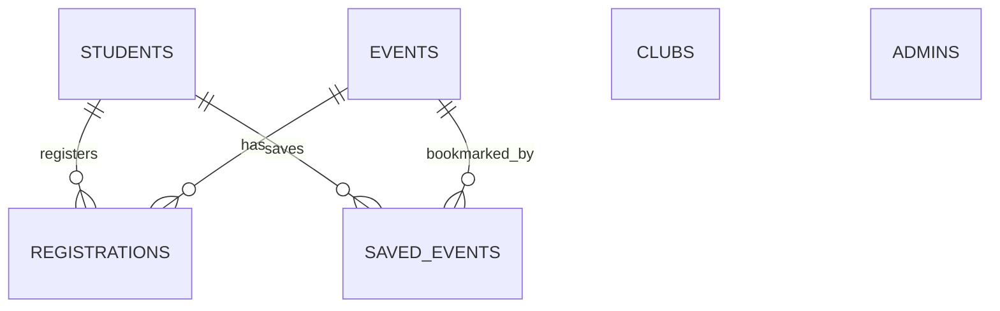

# CampusConnect — Smart Campus Activities Management System

> **“Your campus. Your people. Your possibilities.”**

CampusConnect is a modern Java desktop application designed for a B.Tech Advanced Object-Oriented Programming (OOP) college project. It centralizes information about college clubs, workshops, hackathons, competitions, cultural events, volunteering, and other campus opportunities that are usually scattered across WhatsApp groups, posters, social media, and bulletin boards.

---

## 1. Technology Stack

- **Language:** Java 17 / 21
- **GUI Framework:** Java Swing (`CardLayout`, custom rounded cards, styled components)
- **Database:** MySQL 8.0+
- **Connectivity:** JDBC with `PreparedStatement` & transaction management (`SELECT ... FOR UPDATE`)
- **Security:** `PBKDF2WithHmacSHA256` password hashing via `SecretKeyFactory` & `SecureRandom`
- **IDE Compatibility:** IntelliJ IDEA, Eclipse, NetBeans, and command-line execution (Zero Maven / Gradle complexity)

---

## 2. Visual Design & Theme

The interface adheres to the professional CampusConnect design system:

| Element | Hex Code | Purpose |
|---|---|---|
| **Midnight Navy** | `#101F3C` | Primary branding, top bar, sidebar, and headers |
| **Sky Blue** | `#A9D9FF` | Highlights, badges, and accents |
| **Sunshine Yellow** | `#F8CC4D` | Primary action buttons, active navigation, achievement badges |
| **White** | `#FFFFFF` | Card surfaces and input containers |
| **Pale Blue-Grey** | `#F3F6FA` | Main application background |

### Layout Structure
- **Top Navigation Bar:** CampusConnect brand logo & tagline, global search field, active notifications indicator, student profile pill, and secure logout.
- **Left Sidebar:** High-contrast navy sidebar with navigation items:
  1. 🏠 **Dashboard** (Landing page with personalized welcome, stats, and interest matches)
  2. 🏛️ **Discover Clubs** (Browse, keyword search, and category filters)
  3. 📅 **Events & Opportunities** (Campus events directory with search, type/category filters, details modal, register & bookmark)
  4. 🚀 **Beyond the Classroom** (Dedicated experiential learning directory for hackathons, workshops, competitions, volunteering, and bootcamps)
  5. 🎒 **Campus Passport** (Verified participation records, digital event stamps, and earned achievement badges)
  6. 🗂️ **My Campus** (Personal registrations, saved events, and verified attendance history)
  7. 👤 **My Profile** (Academic details, year of study, and multiple interest selection)
- **Admin Studio:** Authenticated administrative workspace for Club Management, Event Management, and Attendance Verification.

---

## 3. The Three Unique Features

### Feature 1: Opportunity Match
- Students select multiple campus interests in **My Profile** (e.g., Programming, AI, Design, Entrepreneurship, Social Impact).
- Rule-based engine matches student interests with event and club categories.
- Surfaces a dedicated section on the student Dashboard titled **“Picked for Your Interests”**.
- Ranks matches by score and event proximity.
- Explains every recommendation: e.g. *“Matches your interest in Technology”* or *“Matches your interests in Programming & Artificial Intelligence”*.
- Instant refresh when student interests are modified.

### Feature 2: Beyond the Classroom
- Dedicated opportunity directory specifically tailored for out-of-classroom experiential learning:
  - 💻 Hackathons
  - 🛠️ Workshops
  - 🏆 Competitions
  - 🤝 Volunteering
  - 🎭 Cultural Activities
  - 🚀 Entrepreneurship
  - 📈 Skill Development
- Features quick opportunity type pills, category filters, and keyword search.
- Displays eligibility, registration deadlines, venue, organizer, and live remaining seat counts.
- Directly uses the existing `events` table without database bloat.

### Feature 3: Campus Passport
- Digital verified participation record: **Registration alone does not award a stamp**.
- Only administrator-verified attendance (`ATTENDED`) earns participation credit and unlocks digital event stamps.
- Automatically calculates milestone achievements:
  - 🥇 **First Event:** First verified campus event attended.
  - 💻 **Tech Explorer:** 3+ verified technology events attended.
  - 🤝 **Community Contributor:** 2+ verified volunteering or social impact activities.
  - 🎨 **Creative Mind:** 2+ verified cultural or design events.
  - ⭐ **All Rounder:** 5+ verified events across various campus categories.

---

## 4. Simplified Database Architecture (6 Tables)

The database schema strictly adheres to a normalized 6-table design:



1. **`students`**: Student ID, full name, unique email, `password_hash`, `salt`, `hash_iterations`, department, year of study, delimited `interests`, and creation timestamp.
2. **`admins`**: Admin ID, full name, unique email, `password_hash`, `salt`, `hash_iterations`, `admin_level`, and creation timestamp.
3. **`clubs`**: Club ID, name, category, description, contact email, contact location, and active status.
4. **`events`**: Event ID, title, description, category, opportunity type, date, venue, organizer, registration deadline, eligibility, capacity, available seats, registration open flag, and active status.
5. **`registrations`**: Registration ID, student ID, event ID, registration date, registration status (`REGISTERED` / `CANCELLED`), attendance status (`PENDING` / `ATTENDED` / `NOT_ATTENDED`), verification timestamp, and verifying admin name.
6. **`saved_events`**: Student ID and event ID (composite primary key).

---

## 5. Object-Oriented Programming (OOP) Concepts Demonstrated

| OOP Principle | Implementation in CampusConnect |
|---|---|
| **Encapsulation** | All entities (`Student`, `Admin`, `Event`, `Club`, `Registration`) declare private fields and access them via validated getters, setters, and state encapsulation methods. |
| **Inheritance** | Abstract class `User` acts as the base class for `Student` and `Admin`, reusing core identity attributes (`id`, `name`, `email`, `passwordHash`, `salt`, `hashIterations`, `role`). |
| **Abstraction** | `User` defines the abstract method `public abstract String getDisplayInfo()`. System logic interacts with high-level service interfaces (`AuthService`, `RecommendationService`, `PassportService`), hiding database SQL queries inside DAO classes. |
| **Polymorphism** | Concrete classes `Student` and `Admin` override `getDisplayInfo()` polymorphically. Method overloading and polymorphic collection processing are used in authentication sessions and recommendation rankings. |

---

## 6. Setup & Installation Instructions

### Step 1: Database Setup
1. Open MySQL Workbench or MySQL CLI:
   ```bash
   mysql -u root -p
   ```
2. Execute the setup script located at `sql/campus_connect.sql`:
   ```sql
   SOURCE sql/campus_connect.sql;
   ```
   *(This creates the `campusconnect` database, creates all 6 tables, constraints, indexes, and populates demonstration data).*

3. Configure your database credentials in `db.properties` (in the project root):
   ```properties
   db.url=jdbc:mysql://localhost:3306/campusconnect?useSSL=false&serverTimezone=UTC&allowPublicKeyRetrieval=true
   db.user=root
   db.password=YOUR_MYSQL_PASSWORD
   ```

### Step 2: Running in Java IDEs

#### In IntelliJ IDEA:
1. Open IntelliJ IDEA -> **Open** -> Select `CampusConnect` folder.
2. Go to **File** -> **Project Structure** -> **Project**:
   - SDK: Select Java 17 or higher.
3. In **Project Structure** -> **Modules** -> **Sources**:
   - Mark `src` folder as **Sources Root**.
4. In **Project Structure** -> **Libraries**:
   - Click `+` -> Java -> select `lib/mysql-connector-j-26.10.0.jar`.
5. Open `src/app/CampusConnectApp.java` and click the green **Run** triangle.

#### In Eclipse:
1. **File** -> **Open Projects from File System...** -> select `CampusConnect`.
2. Right-click project -> **Build Path** -> **Configure Build Path...**
3. In **Libraries** tab -> **Add External JARs...** -> select `lib/mysql-connector-j-26.10.0.jar`.
4. Right-click `src/app/CampusConnectApp.java` -> **Run As** -> **Java Application**.

#### From Terminal / Command Prompt:
```bash
# Compile:
javac -d bin -cp "lib/mysql-connector-j-26.10.0.jar;src" src/app/CampusConnectApp.java src/*/*.java src/*/*/*.java

# Run:
java -cp "bin;lib/mysql-connector-j-26.10.0.jar;src" app.CampusConnectApp
```

---

## 7. Default Credentials for Testing

### Administrator Login (Admin Studio)
- **URL / Screen:** Select *"Admin Sign In →"* on the login page.
- **Email:** `admin@campusconnect.edu`
- **Password:** `admin123`
- **Capabilities:** View live calculated statistics, add/edit/archive clubs, create and manage events, and mark student attendance.

### Demonstration Student Login
- **Email:** `alex@campusconnect.edu`
- **Password:** `student123`
- **Interests:** Programming, Artificial Intelligence, Design
- **Pre-populated Stamps:** Already has verified attendances from past workshops to showcase the Campus Passport stamps and achievement badges immediately upon login.

*(Or click **Register** on the sign-in screen to create a brand new student account!)*

---

## 8. Verification & Testing Checklist

- [x] **Student Registration & Login:** Validates email format, password matching, hashes password with PBKDF2-HMAC-SHA256, and prevents duplicate emails.
- [x] **Admin Authentication:** Secure admin login granting access to Admin Studio.
- [x] **Live Admin Dashboard:** Dynamic statistics calculated from SQL queries (Students, Clubs, Events, Upcoming, Registrations, Verified Attendance).
- [x] **Opportunity Match (Feature 1):** Matches student's selected interests with event categories, ranking and explaining reasons. Refreshes immediately when interests are updated.
- [x] **Beyond the Classroom (Feature 2):** Full directory of hackathons, workshops, competitions, volunteering, and cultural events with search and filters.
- [x] **Campus Passport (Feature 3):** Verified attendance displays digital stamps, badges (First Event, Tech Explorer, All Rounder), and live counts.
- [x] **Event Registration & Concurrency:** Prevents duplicate registrations, checks deadlines, decrements available seats safely inside transactions, and supports cancellation.
- [x] **Admin Attendance Verification:** Admin marks students as `ATTENDED`, updating Campus Passport records in real time.
